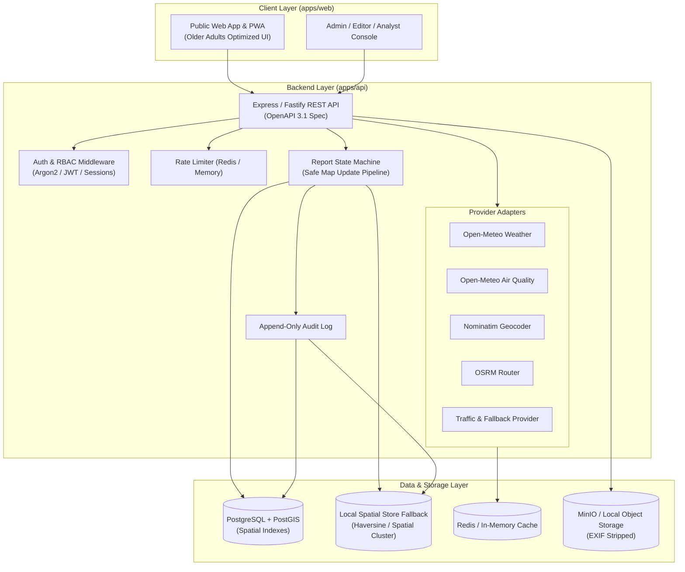

# Architecture Specification — Yol Ma'lumoti

## 1. High-Level System Architecture

---

## 2. Component Responsibilities

1. **`apps/web` (Client Application):**
   - Single responsive React 18+ application with MapLibre GL JS.
   - Design tokens implemented via Tailwind CSS:
     - Outer bg: `#E7E4EA`
     - Card / Panel: `#FFFFFF` / `#F2EFF5` (radius 24-32px)
     - Accent Orange: `#E8593A`, Tint: `#FDE6DF`
     - Dark Pill / Primary: `#151218`
     - Text: `#151218` (min body 18px), Secondary: `#55505A`
   - Accessibility primitives: high-contrast styling, reduce-motion handler, WCAG 2.2 AA standards, screen-reader live regions, alternative list view.
   - Role-aware views for Public, Editor, Admin, and Analyst.

2. **`apps/api` (Backend Engine):**
   - RESTful API with `/api/v1` namespace.
   - Modular structure:
     - `auth/`: registration, login, JWT issuance, rotating refresh tokens, 2FA readiness.
     - `reports/`: 3-step report submission, duplicate detection, lifecycle state machine.
     - `map/`: road features, active incidents, weather layers, geocoding & routing endpoints.
     - `admin/`: proposed map change review, publication, audit log queries, system health.
     - `analytics/`: analyst metrics aggregation, heatmaps, category frequency.
     - `providers/`: adapter interfaces with circuit breakers and caches.

3. **`packages/shared`:**
   - Unified TypeScript types for API requests/responses.
   - Zod validation schemas for forms and payloads.
   - Design token constants and color variables.
   - Permission definitions and role capabilities.

---

## 3. Communication Protocols

- **REST / JSON:** Standard state queries, report submissions, auth mutations.
- **SSE (Server-Sent Events) / Polling:** Real-time updates for report lifecycle events and support messages.
- **Provider Caching:**
  - Weather: 15-minute TTL
  - Air Quality: 30-minute TTL
  - Geocoding: 24-hour TTL
